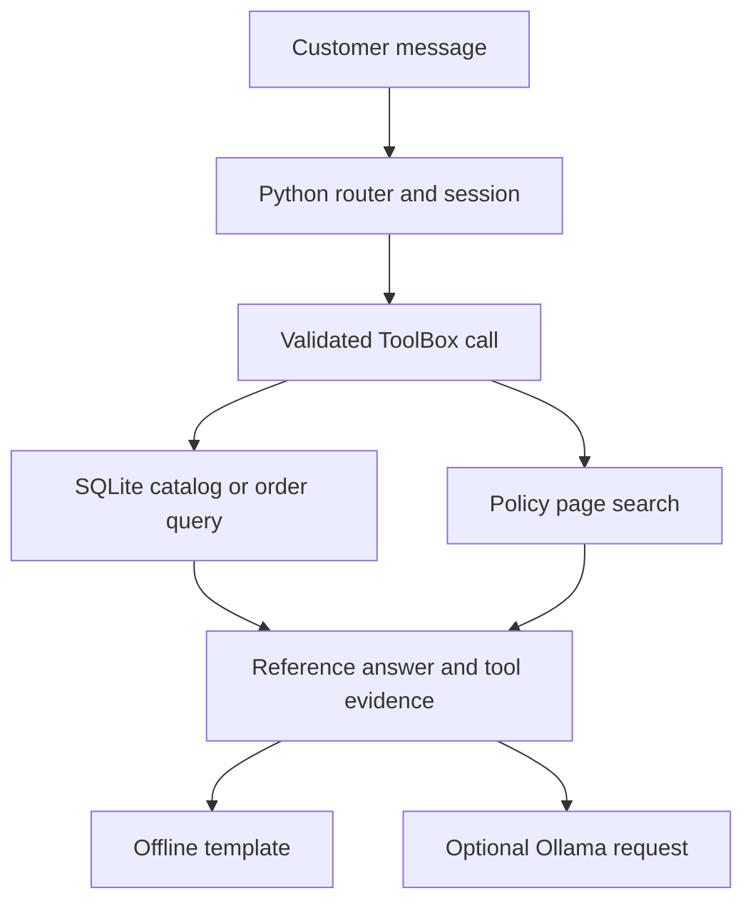

# Architecture

A turn begins in cli.py. chat.py normalizes the message, recognizes supported intents and resolves references from recent product IDs or the last accessible order. A combined request can trigger both order lookup and policy retrieval.

**Operational data.** catalog.py loads the CSV snapshot into SQLite. It validates relationships, filters stock and calculates money in cents. tools.py validates operation names, argument types and ranges. For orders, the WHERE clause includes the session customer ID. An inaccessible order and an unknown order produce the same public result.

**Policies.** policies.py compares the PDF hash with the index, ranks pages by lexical overlap and expands English terms into Portuguese search terms. Related pages add context where rules span sections. The offline router checks the expected page before rendering a reviewed template. A changed PDF invalidates the index.

**Generation.** llm_agent.py obtains the reference response and trace from the same router. With tool evidence it sends one request containing up to four calls and three previous exchanges. Without a trace it returns the router response. llm.py posts JSON to local Ollama with a timeout. Empty answers, connection errors and malformed responses produce explicit errors. The model receives no callable tools or database connection.

**Scope.** The terminal process owns session state. A short manual and four operations make this flow inspectable with standard Python modules. The application reads a supplied snapshot and performs no transactional updates.
